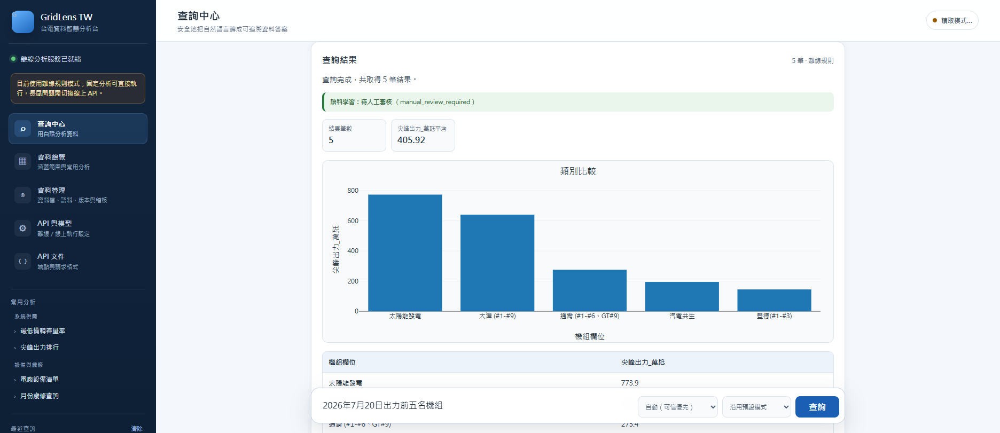
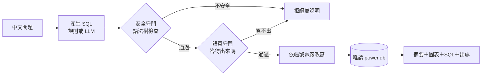

# GridLens TW｜台電開放資料 Text2SQL 智慧查詢系統

> 用中文問台灣電力資料，答案附上「資料能不能支持它」；同時看得到台電每 10 分鐘的即時發電。
> **全程地端**：規則、檢索、模型都在自己的電腦上跑，不需要 API key，問句與資料不送到任何雲端服務。


> GridLens TW 是本 fork 的名稱，原專案為 [lee851104/text2sql_project](https://github.com/lee851104/text2sql_project)（原名 PowerQuery TW）。
> 程式內部仍沿用原本的名稱：指令 `powerquery`、環境變數 `POWERQUERY_*`、套件 `powerquery-tw`。



## 為什麼做這個

想問的人不會寫 SQL，會寫 SQL 的人不知道要問什麼。這個系統讓人直接用中文問，系統產生 SQL、查台電公開資料，用文字、數字和圖表回答。

但只會翻譯還不夠。問「2025 年台灣太陽能發了多少度？」查得到數字，可是那份資料只收台電**自建**場站，約佔全國風光地熱的 **3～4%**——數字看起來完全正常，你不會察覺它不是你要的。所以系統的重心在**守門**：算不出來的題目直接擋下並建議問法；答得出但有範圍限制的，照答並把限制寫在旁邊。即時資料也照同一原則：數字旁一定標出資料時間、收集狀態與異常機組。

## 功能

| | 功能 | 一句話 |
|---|---|---|
| 地端 | [全程在本機](#全程地端) | 離線規則先接，接不住的交給本機 Ollama 模型；不需要 API key、不連任何雲端 LLM |
| 查詢 | [中文轉 SQL ＋ 雙層守門](#查詢與守門) | 規則或本機 LLM 產生 SQL，同一套安全與語意守門 |
| 即時 | [即時收集器](#即時收集器) | 每 10 分鐘收台電機組發電量，先封存再入庫，壞了能重建 |
| 即時 | [即時發電面板](#即時發電面板) | 總覽頁的燈號、各類型出力與今日趨勢，權限與查詢一致 |
| 評測 | [本機 LLM 評測](#本機-llm-評測) | 規則接不住的題目交給本機 Ollama；三組對照實驗量出答案檢查與推理各自的效果 |
| 即時 | [用中文查即時資料](#用中文查即時資料) | 「現在風力發多少」「今天太陽能發了幾度」改查 realtime.db，附資料時間與揭露 |
| 治理 | [資料治理](#資料治理) | 資料異動要第二個人核准才上線，版本可回退、稽核成鏈 |
| 治理 | [語料學習](#語料學習) | 成功查詢經六道檢查與人工核准，才成為新的檢索範例 |
| 權限 | 電廠帳號 | 帳號綁電廠，查詢與即時面板都只給本廠＋跨廠共用資料 |
| 部署 | 本機與公開服務 | Windows 點兩下啟動；公開服務固定只用離線規則、強制登入 |

## 查詢與守門



- **安全守門**用 sqlglot 拆語法樹檢查，只准查審核過的中文語意檢視；SQL 攻擊題庫 16／16 全攔。
- **語意守門**分「拒答／揭露限制／請你講清楚」三級，資料陷阱寫在資料庫裡，不靠提示詞。
- **權限在後端執行**：SQL 通過安全檢查後才由程式依帳號改寫，AI 想繞也繞不過去。同一句「列出台中發電廠所有設備」，全權限帳號 14 筆、林口帳號 0 筆。
- **沒有模型也能用**：沒開 Ollama 時自動退回離線規則；開了才把規則接不住的長尾問題交給本機模型。

## 全程地端

電力資料、帳號與查詢紀錄都不該為了「問一句話」離開這台機器，所以整條管線都在本機：

| 環節 | 在哪裡跑 |
|---|---|
| 規則路由、語意守門、SQL 安全守門 | Python 程式，無網路 |
| 檢索範例（RAG） | 自寫字元 n-gram TF-IDF，索引是 repo 裡的 JSON，不需向量服務 |
| 長尾問題的 SQL 生成 | 本機 [Ollama](https://ollama.com)（預設 `qwen3:8b`），只連 `127.0.0.1:11434` |
| 資料庫 | 唯讀 SQLite 快照 |

- **三種執行模式**（管理頁「本機 LLM」或 `POWERQUERY_RUNTIME_MODE`）：`offline` 只用規則；`local` 一律交給本機模型；`auto`（預設）偵測得到 Ollama 才用，偵測不到就退回規則。
- **設定檔只有本機端點**：[configs/llm.yaml](configs/llm.yaml) 只列 Ollama 的兩種模式，沒有任何雲端端點或金鑰欄位，有測試釘住。
- **公開服務固定離線**：`公開離線啟動.bat` 啟動時設 `POWERQUERY_RUNTIME_MODE=offline`，不把本機模型開給網路上的訪客。
- 唯一會連外的是資料本身：手動下載台電開放資料，以及即時收集器每 10 分鐘抓一次台電公開端點。

## 即時收集器

台電的 `d006001` 只提供「現在」這一筆，錯過就沒了。收集器（`src/ingest/realtime/`）把它變成可以回頭查、可以重建的資料：

- **不漏抓**：時段開始後 5:20 第一次抓，沒更新就 60 秒後再試；連續失敗自動拉長間隔，遵守 `Retry-After`；帶 ETag 做條件式請求。
- **先封存再入庫**：每份原始回應以內容雜湊去重、gzip 封存；`realtime.db` 隨時能從封存**重建**，重建結果與逐筆入庫的 checksum 相同（有測試釘住）。
- **驗證後才採用**：結構錯誤整份拒收（封存仍保留）；數值問題照收但標記品質；11 列小計逐類核對。
- **不會因單一失敗停下**：決定檔被 Excel 存壞、封存寫不進去、資料庫損壞，都只警告或自動復原；真的損壞（`SQLITE_CORRUPT`）才移到旁邊重建。
- **有帳可查**：每次抓取都留紀錄；每日彙總只算可信值，缺口分成「收集器沒跑／抓取失敗／拒收」三種；原始明細保留 14 天、彙總後才清。
- **人工決定、不猜**：204 個機組的粒度與所屬電廠逐一人工確認，執行時不做字串比對推測。
- **單一實例**：作業系統檔案鎖保證只有一份在跑；`即時收集啟動.bat` 異常時自動重啟，可設定開機自動啟動。

## 即時發電面板

「資料總覽」頁最上方：


> 趨勢圖從 08:50 才有線：收集器設定成電腦開機、登入後才啟動並開始呼叫台電 API，之前的時段沒有收到資料。面板照實以空白呈現，不補 0；`d006001` 只提供「現在」這一筆，錯過的時段目前補不回來（`d006010` 歷史資料可以回補，但它晚約四個月，補的是收集器啟動以前的日子，見 RT-2）。

- **燈號**：綠＝收集中且資料新、黃＝落後超過 30 分鐘、灰＝收集器停止或無資料，附最新時段與今天收到幾個時段。
- **各類型總出力**：只加總「正常」的值，通訊異常的機組另計；缺值是空白不是 0；儲能（放電）與儲能負載（充電）分列不相抵。
- **今日趨勢**：每 10 分鐘一點，沒抓到的時段斷線；附可展開的數字表。前景時每 60 秒更新，背景暫停。
- **權限與查詢一致**：電廠帳號只看本廠＋共用，數字拆成「本廠」「共用」兩欄；兩邊電廠名冊對不上就拒絕（409）；訪客政策為 `denied` 時只看得到狀態。
- **誠實揭露**：資料落後、收集器停止、品質警告、非今日資料都在數字旁說明；品質警告的細節涉及全系統，只給全電廠帳號。
- **不經過 Text2SQL**：寫死的 SQL、每次請求唯讀開檔讀同一份快照；收集器更新後網頁不必重啟。

## 用中文查即時資料

問句帶「現在、今天、昨天」等用詞時，查詢中心改查 `realtime.db`（RT-3b）：

- **用詞決定查哪個資料庫**，不是機組名：兩邊有約 21 個同名機組。「哪些機組目前維修中」照舊查歲修排程。
- **兩個資料庫不混用**：同一句 SQL 同時查 `v_rt_*` 與歷史檢視直接拒絕，因為兩邊的機組名稱沒有對照。
- **數字旁一定有資料時間**，並揭露落後、收集器停止、估算發電量、資料完整度、儲能相抵與彙總列。
- **離線規則先接**，接不住的交給本機 Ollama 模型，不需要 API key。
- 已除役或不在即時資料裡的機組（例如 `台中#1`）會直接說沒有，並建議相近名稱。
- **歷史回補（RT-2）**：匯入台電 `d006010`（各機組過去發電量，每月更新、晚約四個月）後，「2026年4月台中#5發電量」也答得出來；答案標出數字來自歷史資料，類型合計不含民營電廠。

## 資料治理

資料管理不是 SQL 編輯器。它只管五個有 schema 約束的 CSV 資料槽：

- **先建候選、再審核**：上傳或移除先檢查格式與跨檔品質，用固定的建置程式產生候選資料庫，狀態停在 `pending_review`，查詢完全不受影響。
- **四眼原則**：必須由**另一個**有審核權的帳號核准；提案人不能核准自己的提案（單人例外要明設環境變數，且照樣留痕）。
- **原子切換、可回退**：核准後驗證 checksum 才切換，服務不必重啟；每個資料庫版本都能回退。
- **稽核成鏈**：上傳、核准、拒絕、失敗、回退都寫進雜湊鏈稽核紀錄，竄改會被發現。
- **管理是全電廠功能**：電廠帳號不能用管理端點，避免從原始檔繞過權限。
- **即時資料的審核方式**：每筆快照由自動驗證放行；會改變結果的規則（解析程式、機組決定檔、設定）才走 PR 審查。

## 語料學習

這裡的「學習」是新增檢索範例，不是微調模型：

- **六道自動檢查**：去識別、重複、題庫洩漏、SQL 與語意守門、結果重播、檢索回歸。
- **一律人工核准**：通過檢查也只停在 `pending_review`；核准時以當下的資料與語料基線重新驗證，成功才發布並熱重載索引。
- **不留結果、遮個資**：只存去識別問句、SQL、驗證結果與資料出處，不存查詢結果；Email、身分證、電話等自動遮罩。
- **資料換版就重驗**：資料庫版本變更時備份舊語料、重建索引，已發布的範例退回待審，避免沿用舊資料的答案。
- **題庫不准當訓練資料**：評測題目進不了語料，評測數字才可信。

## 實測數字

| 項目 | 結果 |
|---|---:|
| 機組主檔對齊 | 175 台，100% |
| 每日出力長表 | 36,928 筆（2025-01-01 ～ 2026-07-31） |
| 即時機組人工決定 | 248 個（即時 204＋只在 d006010 歷史資料 44），0 個未定 |
| 離線評測 | 意圖 80／80、執行 60／60、語意陷阱端到端 45／45 |
| 守門誤攔／SQL 攻擊 | 0／20 誤攔、16／16 攔截 |
| 測試 | 1,309 項（66 個測試檔），CI 全程離線、不需模型 |

完整指標與消融見 [reports/eval_summary.md](reports/eval_summary.md)。上面都是離線規則路徑的成績；規則接不住、交給 LLM 的那一部分另外量，見下一節。

## 本機 LLM 評測

規則接得住的題目不打 LLM；接不住的才交給本機的 Ollama（`qwen3:8b`，資料不外送）。
它到底答得多好，原本沒有人量過，所以做了一份專門的評測：

- **題庫**：[benchmarks/llm_questions.json](benchmarks/llm_questions.json)，20 題「離線規則接不住、但資料答得出來」的問題，
  每題附人工核對過的標準答案 SQL。測試會確認每一題真的到得了 LLM：規則變強就換題，不讓分數悄悄變好看。
- **比對**：執行模型寫的 SQL，與標準答案比**值**（不看欄名與順序，瓩／萬瓩都算對），並區分「答對」「答錯但看起來正常」「沒有回答」。
- **工具**：`uv run --extra local python -m eval.llm_eval`（加 `--no-rag` 關掉檢索範例做對照），報告在 [reports/](reports/llm_eval_ollama_thinking.md)。

三組對照實驗，把兩個改動的效果分開：

| | 推理開、無檢查 | 推理關＋檢查 | 推理開＋檢查 |
|---|---:|---:|---:|
| 答對 | 7 | 6 | **10** |
| 答錯但看起來正常 | 5 | 5 | **1** |
| 沒有回答（逾時、守門擋下） | 8 | 9 | 9 |
| 每題秒數（中位數） | 255 | **11** | 372 |

- **答案檢查有效**（左→右，推理都開）：答對 7→10，看不出來的錯 5→1。檢查專抓「看起來正常、其實答錯」的寫法——
  值不在欄位的值清單（`縣市 = '新北市'`，資料裡是「新北市林口區」）、`LIKE` 沒有 `%`、數字被當成字串比較、結果被 LIMIT 截斷——
  發現就把原因交回模型重寫。程式在 [src/text2sql/answer_checks.py](src/text2sql/answer_checks.py)。
- **推理撐起準確率，但很慢**（中→右，檢查都有）：關掉推理快 30 倍，答對卻從 10 掉到 6，多出來的錯都是推理錯（取錯筆數、年份範圍、查錯資料表），檢查看不到。
- **放寬時間沒用**：推理開時有 7 題 900 秒都寫不完，是推理停不下來，不是硬體慢。

**RAG 是不是拖累？**另外做了一組對照：同一模型、推理關，只差有沒有給檢索範例。

| | 有 RAG 範例 | 關掉 RAG |
|---|---:|---:|
| 答對 | 5 | 5 |
| 答錯但看起來正常 | 5 | 5 |
| 沒有回答 | 10 | 10 |

總分一樣，但有 7 題的結果變了、方向兩邊都有：範例查的是同一張表時它幫得上忙（「台中#1 7 月平均尖峰出力」照範例寫出 `AVG` 與正確月份），
範例只是字面像時它會帶偏（「哪一座電廠的機組數最多」照抄核能範例去查 `v_peak` 並加上 `類別 = '核能'`，關掉 RAG 反而答對）。
所以準確率低主要不是 RAG 造成的——打開推理才是從 6 到 10 的那一步；但字元 n-gram 檢索只懂字面，換成語意檢索（例如本機的 `bge-m3` 向量）是下一個可改的地方。
同一設定重跑一次答對數會差 1 題，20 題的差距要當量級看。報告：[有 RAG](reports/llm_eval_ollama_rag.md)、[關 RAG](reports/llm_eval_ollama_no_rag.md)，過程見 CP-094。

所以設計成**規則為主、本機 LLM 補位**，提供兩種模式：`POWERQUERY_LLM_PROVIDER=ollama`（推理關，每題約 11 秒，預設）與
`ollama-reasoning`（推理開，較準但每題數分鐘）。LLM 寫的 SQL 一樣要過語法樹守門、語意守門與權限改寫，不是信任邊界。
限制：只有 20 題、8B 模型在筆電上跑，數字是量級而不是精確的準確率。過程記在 [log.md](log.md) CP-088～090。

## 技術

Python＋uv（鎖版本可重現）、SQLite（唯讀開檔；即時資料用 WAL）、sqlglot（語法樹守門）、FastAPI、原生 HTML／CSS／JS（不需 Node）、Plotly.js（鎖版本＋SRI）、自寫字元 n-gram 檢索（離線、不需向量服務）、Ollama（本機 LLM，經 OpenAI 相容端點）、pytest＋ruff＋GitHub Actions（每個 PR 附合併門檻報告）。

踩過的坑（官方憑證鏈、PowerShell 的 BOM、浮點小計誤判、靜態檔快取、Big5 主控台讀壞開機檔⋯⋯）都記在 [log.md](log.md) 與 [docs/SPEC.md](docs/SPEC.md)。

## 快速開始

**Windows**：點兩下 `啟動.bat`，瀏覽器會開在 <http://127.0.0.1:8765/>（不需 API key；有開 Ollama 就自動用本機模型，沒開就用離線規則）。要用本機模型，先裝 [Ollama](https://ollama.com) 並執行 `ollama pull qwen3:8b`。要看即時發電，再點兩下 `即時收集啟動.bat`（每 10 分鐘連線台電一次）；`停止即時收集.bat` 停止，`開機自動啟動-即時收集.bat` 放進 `shell:startup` 就能登入後自動收集。

**開發者**：需要 Python 3.12 以上（`.python-version` 釘在 3.12，uv 會自動選用或下載；3.11 關不掉 SQLite 的雙引號字串相容行為，查詢會拒絕執行）。

```bash
make setup && make db && make serve          # 安裝、建快照、啟動 http://127.0.0.1:8000
uv run powerquery "2026年7月備轉容量率最低是哪一天？"
uv run python -m ingest.realtime status      # 另有 run / once / rebuild / stop
make test-all && make eval                   # 全套測試與離線評測
```

帳號、本機 LLM、資料管理流程見 [docs/SERVING.md](docs/SERVING.md)；公開服務見 [PUBLIC_OFFLINE_SERVING.md](PUBLIC_OFFLINE_SERVING.md)。

## 資料來源與文件

八份[政府資料開放平臺](https://data.gov.tw/)台電資料集（機組設備、電力供需、大修排程、發電成本、再生能源場址與發電量、核能機組、各機組發電量即時資訊），清單與用途見 [docs/SPEC.md](docs/SPEC.md)，血緣見 [docs/lineage/](docs/lineage/)。「過去電力供需資訊」與即時資料都只提供近期，所以原始檔一律以 SHA-256 封存。

| 想知道 | 看這裡 |
|---|---|
| 設計與踩坑 | [SPEC](docs/SPEC.md)、[設計規格](docs/superpowers/specs/2026-09-09-text2sql-taipower-design.md) |
| 操作與 API | [SERVING](docs/SERVING.md)、[API 契約](src/serving/API_CONTRACT.md) |
| 即時發電 | [來源分析](docs/REALTIME_INGEST.md)、[收集器規格](docs/superpowers/specs/2026-09-24-realtime-ingest-design.md)、[面板規格](docs/superpowers/specs/2026-10-05-realtime-panel-design.md) |
| 守門與評測 | [語意守門](docs/SEMANTIC_GUARD.md)、[Text2SQL 管線](docs/TEXT2SQL_PIPELINE.md)、[評測](docs/EVALUATION.md) |
| 資料 | [資料字典](docs/DATA_DICTIONARY.md)、[對齊方法](taipower_align/README.md)、[擴充計畫](docs/DATA_ROADMAP.md) |
| 用途與限制 | [系統卡](docs/SYSTEM_CARD.md) |
| 開發紀錄與回退 | [log.md](log.md) |

## 授權

**資料**：台灣電力公司公開資料，依「[政府資料開放授權條款－第 1 版](https://data.gov.tw/license)」使用。再次散布時請保留資料提供機關顯名、快照版本與來源資訊。

**程式與自寫文件**：本專案目前**未提供 `LICENSE` 檔**。政府資料開放授權條款只適用於其涵蓋的開放資料，不會自動授權本專案的程式碼、介面、設計規格或自寫文件；除另有書面授權外，請勿推定採用任何開源授權。

台電資料的顯名不代表台灣電力公司為本專案、資料轉換結果或分析結論背書。分析用的 `power.db` 是固定時間取得的**快照**；「資料總覽」頁的即時發電區塊每 10 分鐘取自台電 `d006001`，可能落後或中斷，頁面會標出資料時間。兩者都**不能作為供電或調度決策依據**。

完整顯名、再散布規則與排除清單見 [ATTRIBUTION.md](ATTRIBUTION.md)。
